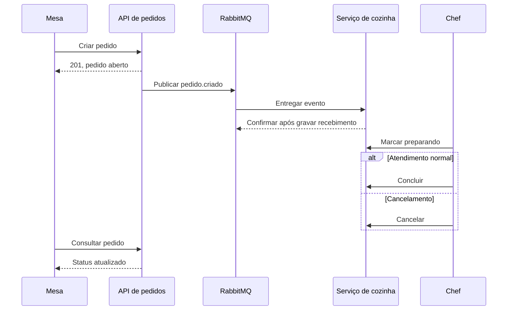

# ChefSystem — pedidos da mesa à cozinha

API Spring Boot para cadastrar mesas e produtos, registrar pedidos e acompanhar o preparo. O envio de novos pedidos à cozinha passa pelo RabbitMQ. Use o Swagger UI para testar o fluxo.

## Executar no Windows, Linux ou macOS

Com o Docker Desktop ou Docker Engine com Compose ativo, abra o terminal na pasta deste arquivo:

```sh
docker compose up --build -d
docker compose logs -f app
```

Na primeira execução, o Flyway cria o banco PostgreSQL e inclui mesas e produtos de demonstração. Quando aparecer `Started ChefsystemApplication`, abra:

| Recurso | Endereço |
|---|---|
| Swagger UI | http://localhost:8080/swagger-ui/index.html |
| OpenAPI (JSON) | http://localhost:8080/v3/api-docs |
| RabbitMQ Management | http://localhost:15672 |

Para entrar no RabbitMQ local, use `chefsystem` / `chefsystem-local` ou as credenciais configuradas no ambiente. O Compose limita as portas publicadas ao computador local.

Para desligar sem apagar os dados, use `docker compose down`. A configuração é local; as senhas padrão devem ser substituídas se o ambiente for publicado.

### Executar a aplicação pela IDE

Instale o JDK 21 e inicie só o RabbitMQ: `docker compose up -d rabbitmq`. Depois execute `./gradlew bootRun` (Linux/macOS) ou `.\gradlew.bat bootRun` (PowerShell). Nesse modo o banco padrão é H2 em memória e os dados são recriados ao reiniciar a aplicação. Use o Compose completo para manter o banco e as mensagens entre reinicializações.

## Demonstração para a aula

1. Abra o [Swagger UI](http://localhost:8080/swagger-ui/index.html). Use **Try it out** e **Execute**. Em um banco novo, `GET /cozinha/pedidos` já lista o pedido de exemplo #1, que pode ser usado para testar o status imediatamente. Para testar também a entrega pelo RabbitMQ, crie um pedido novo conforme o passo 2.
2. Consulte `GET /mesas` e `GET /produtos` para obter os IDs. Crie um pedido em `POST /pedidos` e guarde o ID retornado.
3. Consulte `GET /cozinha/pedidos` até o pedido aparecer. Depois, use `PATCH /cozinha/pedidos/{id}/status` para marcá-lo como `PREPARANDO` e então como `CONCLUIDO`. Consulte `GET /pedidos/{id}` para conferir a mudança.
4. Para demonstrar o cancelamento, crie outro pedido, aguarde a entrega à cozinha e mude seu status para `CANCELADO`. A API devolve ao estoque a quantidade reservada.
5. No [RabbitMQ Management](http://localhost:15672), veja o exchange `chefsystem.pedidos` e a fila `chefsystem.cozinha.pedidos`. Se a fila estiver vazia com o consumidor ativo, confira nos logs da aplicação a publicação e o recebimento pelo número do pedido.

## Como as classes conversam



| Pacote ou classe | Responsabilidade |
|---|---|
| `pedido.services.PedidoService` | Valida mesa, itens e estoque. Grava o pedido e a reserva de estoque na mesma transação. |
| `pedido.mensageria.PedidoCriadoPublisher` | Busca pedidos pendentes e publica o evento JSON com `RabbitTemplate`. |
| `config.mensageria.RabbitConfig` | Cria os exchanges diretos, filas duráveis e bindings. |
| `cozinha.mensageria.PedidoCriadoConsumer` | Recebe o evento com `@RabbitListener` e chama o serviço da cozinha. |
| `cozinha.services.CozinhaService` | Registra o recebimento, valida as mudanças de status e devolve estoque no cancelamento. |

A mesa recebe `201 Created` assim que o pedido é gravado no banco. O publicador envia depois e marca o envio somente após confirmação do RabbitMQ e verificação de roteamento. Se o broker estiver indisponível, o pedido fica pendente para nova tentativa. O consumidor confirma o processamento depois que o recebimento foi gravado; uma entrega repetida preserva o primeiro recebimento. Se o consumo falhar, o RabbitMQ encaminha a mensagem para `chefsystem.cozinha.pedidos.dlq`.

O status tem uma única fonte: o pedido no banco. A cozinha atualiza o status pela API e o cliente pode consultá-lo pela rota do pedido. O evento RabbitMQ é usado para encaminhar o novo pedido à cozinha. A cozinha é um módulo do mesmo backend e compartilha o banco com pedidos.

## API

Abra o [Swagger UI](http://localhost:8080/swagger-ui/index.html) para navegar pelas rotas e testar requisições com **Try it out** e **Execute**. A especificação em JSON fica em [`/v3/api-docs`](http://localhost:8080/v3/api-docs).

| Método | Rota | Uso |
|---|---|---|
| POST | `/pedidos` | Registra um pedido de mesa |
| GET | `/pedidos?mesaId=1` | Lista pedidos daquela mesa; sem filtro, lista todos |
| GET | `/pedidos/{id}` | Consulta itens, total e status real |
| GET | `/cozinha/pedidos` | Lista pedidos recebidos pelo consumidor |
| PATCH | `/cozinha/pedidos/{id}/status` | Atualiza o status do pedido na cozinha |
| GET, POST | `/mesas`, `/produtos` | Lista ou cadastra mesas e produtos |
| GET, PUT, DELETE | `/mesas/{id}`, `/produtos/{id}` | Consulta, atualiza ou exclui registros; vínculos históricos são preservados |

Corpo para criar um pedido em `POST /pedidos`:

```json
{
  "mesaId": 1,
  "itens": [
    { "produtoId": 1, "quantidade": 2 },
    { "produtoId": 3, "quantidade": 1 }
  ]
}
```

`ABERTO` é o status inicial atribuído na criação; não é um destino permitido na atualização. Use o ID retornado em `PATCH /cozinha/pedidos/{id}/status`, primeiro com `{"status":"PREPARANDO"}`, depois com `{"status":"CONCLUIDO"}`. O chef também pode enviar `{"status":"CANCELADO"}` enquanto o pedido está aberto ou preparando. O backend rejeita transições inválidas e tentativas de atualizar antes de a cozinha receber o pedido com HTTP 409.

## Testes

Com JDK 21, execute `./gradlew test` ou `.\gradlew.bat test` no PowerShell. Os testes HTTP usam H2 e cobrem criação, preparação, conclusão, cancelamento, estoque e rejeição de dados inválidos.

Para testar publicação, consumo e DLQ com RabbitMQ real, suba um broker local de teste sem outras aplicações conectadas (`docker compose up -d rabbitmq`) e execute:

- Linux/macOS: `CHEF_TEST_RABBIT=true ./gradlew test --rerun-tasks`
- PowerShell: `$env:CHEF_TEST_RABBIT = 'true'; .\gradlew.bat test --rerun-tasks`

Os scripts Flyway existentes foram preservados. A migração V7 converte pedidos antigos de `ENTREGUE` para `CONCLUIDO`, cria os itens e adiciona o controle de entrega. A migração V8 completa o pedido de exemplo da V6, acrescenta um item, reserva uma unidade do estoque e registra o recebimento pela cozinha. Ela só aproveita o pedido legado aberto e sem itens quando há estoque para o item de exemplo. Nenhum evento é publicado para esse pedido; crie outro via API para demonstrar a mensageria.
